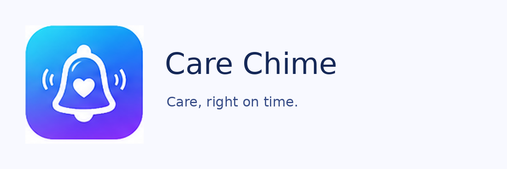

# Care Chime



> **Care, right on time.**

Care Chime is an **offline-first Android health-care organizer** planned for medicine and water reminders, actual-dose logging, family profiles, hospital IDs, medical history, vaccination records, and encrypted portable backups. A companion Angular web app may come later.

**Project status: records foundation (pending GitHub Actions verification).** The app stores, on device only, family profiles (with automatically calculated age), unlimited hospitals and patient IDs per profile, allergies (medication and other), existing conditions, dated medical history, a reusable medicine library and profile-specific prescribed medicine records. Reminder scheduling rules exist as tested pure domain code only. **It does not yet schedule alarms or notifications, provide dosage guidance, or produce encrypted backups.** Do not rely on it for medication reminders.

| Property | Value |
| --- | --- |
| Repository | [actionanand/care-chime](https://github.com/actionanand/care-chime) |
| App name | Care Chime |
| Tagline | Care, right on time. |
| Application ID | `com.actionanand.carechime.app` |
| Android | Kotlin + Jetpack Compose |
| Build | Gradle, `main-android` workflow |
| Future web | Angular companion with versioned encrypted data exchange |

## Quick start

Requirements: Java 21, Gradle 9.5.0, Android SDK matching `android-sdk.properties`, Android Studio optional.

```bash
python3 scripts/validate-config.py
python3 -m unittest discover -s scripts/tests -v
python3 scripts/check-source-policy.py
python3 scripts/check-room-schemas.py  # every Room schema version committed under app/schemas
bash scripts/build-android.sh debug   # optional: needs JDK 21, Gradle 9.5 and the Android SDK
```

Android compilation, lint, unit tests (including Robolectric Room tests) and APK/AAB builds are verified by GitHub Actions: **Care Chime Android CI checks** runs on every feature branch and pull request and uploads a debug APK for device testing; the release workflow runs only on `main-android`.

Android project lives **at the repository root** (`app/`, `settings.gradle.kts`, etc.), matching the LocalTell convention. There is no committed Gradle wrapper JAR; install Gradle 9.5 locally or let GitHub Actions supply it.

## Repo structure

```text
app/                          Native Compose app (domain / data (Room) / ui layers)
app/schemas/                  Exported Room schema JSON (migration baseline)
app-config.json               App identity, name, tagline, release file prefix
android-version.json          versionCode and versionName source of truth
android-sdk.properties        Compile/target/min SDK and Build Tools versions
.github/workflows/            android-ci.yml (branches/PRs) + android-build.yml (main-android release)
branding/                     Generated branding PNGs
scripts/                      Build, signing, validation, source policy, keystore, version bump
releases/                     GitHub-built APK/AAB outputs (latest only)
docs/                         Architecture, reminder, data, backup, web and builds
Agent.md + AGENTS.md          AI implementation directions
```

## Branch and releases

1. Create `main-android` from `master` once.
2. Add the four required signing secrets for signed builds, or build clearly marked unsigned artifacts initially.
3. Push to `main-android`, or run **Care Chime Android APK and AAB** manually from that branch.
4. CI validates + tests, increments `versionCode`, builds APK/AAB, optionally signs both, uploads artifacts, and commits the version and `releases/` contents back to `main-android`.
5. `versionName` is manually managed (`python3 scripts/bump-android-version.py --patch` etc.).

**Full instructions:** [docs/ANDROID.md](docs/ANDROID.md).

## Documentation

- [Architecture](docs/ARCHITECTURE.md)
- [Medication reminder state machine](docs/REMINDER_ENGINE.md)
- [Data model](docs/DATA_MODEL.md)
- [Portable encrypted backup design](docs/BACKUP_ENCRYPTION.md)
- [Web companion strategy](docs/WEB_FUTURE.md)
- [Security and privacy](docs/SECURITY.md)
- [Phased roadmap](docs/ROADMAP.md)
- [Android build & signing](docs/ANDROID.md)
- [Codex/Copilot starter prompt](docs/CODEX_COPILOT_HANDOFF.md)

## Security and medical safety

All health data should remain on device by default. A complete restore must be atomic. Do not log personal health details or silently upload them. This project is a **recording and reminder tool**, not a medical decision engine. Never calculate pediatric doses from age alone or automatically recommend an early, extra, or catch-up dose.

## Reference

Release conventions are adapted from [LocalTell's Android guide](https://github.com/actionanand/local-tell/blob/master/docs/ANDROID.md) and its Android workflow. The application itself is **not copied from LocalTell**.
